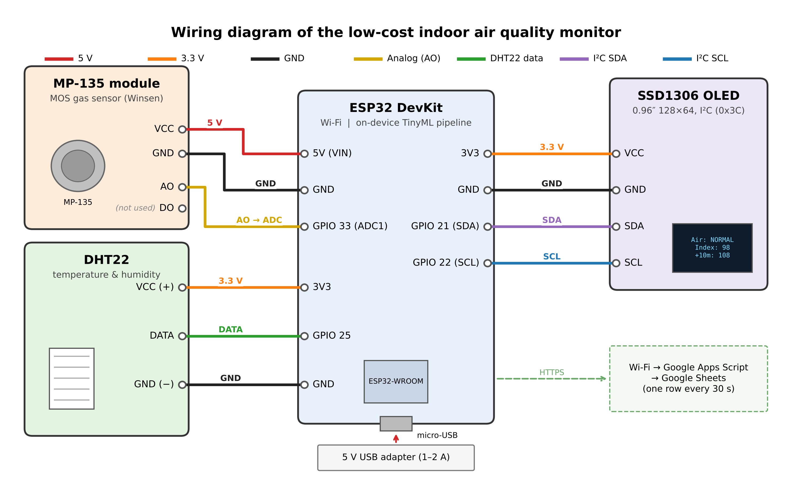

# Indoor air quality dataset from a low-cost ESP32 monitor

Measurements from a low-cost indoor air monitor built from an **ESP32**, a **Winsen MP-135 metal-oxide (MOS) gas sensor**, a **DHT22** temperature and humidity sensor and an **SSD1306 OLED**. It logged one reading every 30 seconds in a room in Dhaka, Bangladesh, from **16 October to 1 November 2026**.

This is the data behind the study *Low-Cost Indoor Air Quality Monitoring and Short-Term Forecasting on ESP32 Using a Humidity-Compensated MOS Sensor and TinyML*.

| | |
|---|---|
| Rows | 46,897 (one every 30 s) |
| Period | 2026-10-16 00:00 – 2026-11-01 22:06, local time (Asia/Dhaka, UTC+6) |
| Columns | 19 |
| Missing values | none |
| Files | `data/indoor_air_quality_esp32.csv` and the same table as `.xlsx` |
| Licence | data CC BY 4.0, code MIT |

> **Important:** the *Pollution Index* is a **relative** index for this room (100 = its usual level). It is **not** an official Air Quality Index, and the MP-135 cannot measure any single gas in ppm. Fine dust (PM2.5) is not measured.

---

## Repository contents

```
data/
  indoor_air_quality_esp32.csv      the dataset
  indoor_air_quality_esp32.xlsx     the same dataset as Excel
notebook/
  Air_Quality_TinyML_Training.ipynb training and evaluation notebook (runs in Google Colab)
firmware/AirQualityLive/
  AirQualityLive.ino                ESP32 firmware (live index + on-device forecast)
  aq_model.h                        the trained LightGBM model exported to C
docs/
  circuit_diagram.png / .svg        wiring diagram
```

## Hardware

| Part | Connection |
|---|---|
| ESP32 DevKit | – |
| Winsen MP-135 module (5 V) | AO → GPIO 33 (12-bit ADC) |
| DHT22 | data → GPIO 25 (no external pull-up resistor) |
| SSD1306 OLED 128×64 | I²C, SDA → GPIO 21, SCL → GPIO 22 |

Readings were sent every 30 s over Wi-Fi to Google Sheets through a Google Apps Script web app.



## How the derived values are calculated

1. **Sensor resistance:** `rs = (Vc / V − 1) · RL`, with `V = gas_adc / 4095 · 3.3 V`, `Vc = 5 V` and `RL = 1 kΩ`.
2. **Ratio:** `ratio = rs / R0`, where `R0 = 11.819 kΩ` is the 75th percentile of `rs` over the calibration week.
3. **Humidity and temperature compensation:** `ratio_comp = ratio / exp(A + B_H · Humidity + B_T · Temp)`, with `A = 4.4367`, `B_H = −0.027602` and `B_T = −0.087963`. These were fitted as a linear model of `log(ratio)` on the calibration week.
4. **Pollution Index:** `100 × (2.5-min mean of 1/ratio_comp) ÷ (median of 1/ratio_comp over the previous 3 hours)`. 100 means the usual level for that time, and 130 means 30 % above it. Because the baseline is rolling, slow sensor drift cancels out.
5. **Air-quality class:** from `Pollution Index / 100`, using the 75th, 95th and 99th percentiles of the calibration week:

| Class | Name | Pollution Index |
|---|---|---|
| 0 | Normal | ≤ 105.33 |
| 1 | Slightly Elevated | 105.33 – 123.47 |
| 2 | Elevated | 123.47 – 139.71 |
| 3 | Spike | > 139.71 |

In this room, the Spike events were caused by air-freshener sprays.

## Columns

| Column | Unit | Description |
|---|---|---|
| `Time` | local time | Time of the reading (Asia/Dhaka, UTC+6) |
| `Temp C` | °C | Temperature (DHT22) |
| `Humidity %` | % RH | Relative humidity (DHT22) |
| `gas_adc` | 0–4095 | Raw 12-bit ADC value of the MP-135 analog output |
| `gas_delta` | ADC counts | Change in `gas_adc` from the previous reading |
| `humidity_delta` | % RH | Change in humidity from the previous reading |
| `temp_delta` | °C | Change in temperature from the previous reading |
| `rolling_mean` | ADC counts | Mean of `gas_adc` over the last 10 readings |
| `rolling_std` | ADC counts | Standard deviation of `gas_adc` over the last 10 readings |
| `rs` | kΩ | Sensor resistance (step 1) |
| `ratio` | – | `rs / R0` (step 2) |
| `ratio_comp` | – | Humidity- and temperature-compensated ratio (step 3) |
| `Pollution Index` | – | Relative index, 100 = usual level (step 4) |
| `current_class` | 0–3 | Class of the current reading (step 5) |
| `Air Quality` | text | Name of `current_class` |
| `target_2m` | 0–3 | Class 2 minutes later (4 readings ahead) |
| `target_5m` | 0–3 | Class 5 minutes later (10 readings ahead) |
| `target_label` | 0–3 | Class 10 minutes later (20 readings ahead); the main forecasting target |
| `split` | text | `calibration`, `development` or `test` (see below) |

## Time-based split

| Split | Dates | Rows | Use |
|---|---|---|---|
| `calibration` | 16–22 Oct | 18,852 | fitting R0, the compensation model and the class thresholds |
| `development` | 23–29 Oct | 19,879 | model training and tuning |
| `test` | 30 Oct – 1 Nov | 8,166 | held-out test, used once |

Class counts (`current_class`): Normal 33,483 · Slightly Elevated 10,724 · Elevated 2,084 · Spike 606.

## Reproducing the results

1. Open `notebook/Air_Quality_TinyML_Training.ipynb` in [Google Colab](https://colab.research.google.com).
2. Run all cells. With `DATA_SOURCE = 'upload'`, the notebook asks you to upload the dataset (`.xlsx` or `.csv`).
3. The notebook trains the models, evaluates them on the test days at 2, 5 and 10 minutes, saves the figures and tables, and exports `aq_model.h` for the ESP32.

The on-device model is a LightGBM regressor (60 trees, 8 leaves) that predicts the change in the Pollution Index 10 minutes ahead. It was exported to C with m2cgen (about 60 KB) and takes about 86 µs per prediction on the ESP32.

## Firmware

To use the firmware, open `firmware/AirQualityLive/AirQualityLive.ino` in the Arduino IDE. Fill in your own Wi-Fi name, password and Apps Script URL, then upload it to the ESP32. Libraries needed: DHT sensor library (Adafruit), Adafruit SSD1306 and Adafruit GFX.

## Limitations

- One sensor, one room, about 17 days. The data has no reference instrument, so the values are relative, not absolute concentrations.
- MOS sensors respond to many gases at once (alcohol, VOCs, H₂, CO) and drift over time.
- The DHT22 has an accuracy of about ±0.5 °C and ±2–5 % RH.

## Citation

If you use this dataset, please cite it. GitHub shows the citation under **"Cite this repository"**, and the DOI will be added here once it is archived on Zenodo.

## Licence

- Data (`data/`): [Creative Commons Attribution 4.0 International (CC BY 4.0)](https://creativecommons.org/licenses/by/4.0/)
- Code (`notebook/`, `firmware/`): MIT licence

See [LICENSE](LICENSE).
